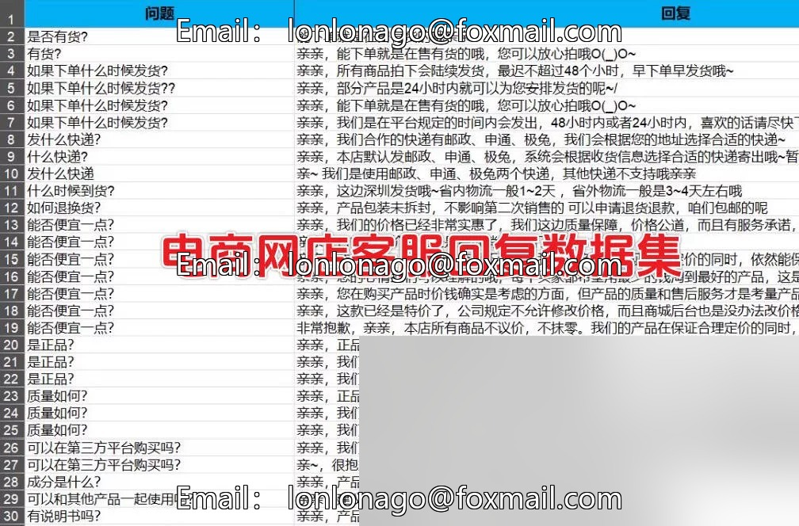

# E-commerce online store response dataset

## Body

E-commerce online store reply dataset

A total of 24,550 Q&A data records, in Excel format, applicable to various scenarios such as training of AI large models and constructing intelligent agent knowledge bases.
These are common problems and standard replies for in actual operations; the content is concise and clear, helping to enhance the efficiency and accuracy of intelligent systems.

web-based shipment, can be directly photographed and shipped.

This dataset contains customer service Q&A for e-commerce stores, totaling 24,550 items covering logistics, courier selection, return/exchange, coupon usage, contact methods, and international delivery; it is in Excel format and suitable for AI large model training and agent knowledge base construction.

<!-- AI_ENRICHED -->

## Images

## Payment

Here is a pay link on Stripe ( https://buy.stripe.com/3cs8yP7sY87d0vu9AB ). Please contact me lonlonago@foxmail.com after funding $89, and I will send you a complete data files , thank you!

